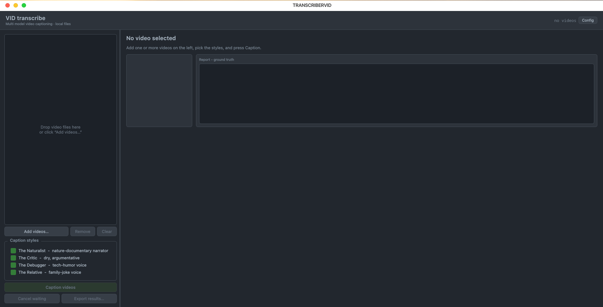

# Video Transcriber

hello mate! how to use? pick some short video files from your computer, choose the caption styles you want, press one button, and the app will think really hard about your funny video HAHA!



> The app is now a desktop app (PyQt6). No browser, no backend, no yt-dlp. It only reads **local video files**.

# APP README

so im too lazy to write another readme, so if you use the AppImage please follow this:

1. **Download** the `.AppImage` from the github release
2. **Make it executable**
   ```bash
   chmod +x VideoCaptioner-x86_64.AppImage
   ./VideoCaptioner-x86_64.AppImage
   ```
3. **Add your key** before anything else, press the **Config** button (top right), paste your `HACKCLUB_API_KEY`, press save. Groq key is optional, only needed if you use a `groq:` model. you can also change the AI models there, just remember to always press save after you done editing
4. **Add videos** with **Add videos...**, or just drag and drop files (even folders) into the window. it accepts mp4, mov, mkv, webm, avi, m4v, flv, wmv, mpg, mpeg, 3gp and ts
5. **Pick styles**, tick the personas you want (all four are ticked by default), then press **Caption videos**
6. **Get the results**, click a video in the list to see the description, the captions, the judge scores and a Copy button. right click a video for Re-run / Open file / Show folder / Remove. when you are done press **Export results...** and it saves everything as a JSON file

Where is my config? the app keeps it in `~/.config/VideoCaptioner/config.json` (created on the first run). if you run it from source (`python qt_app.py`) it uses the `config.json` next to the code instead.

## Why I built this

so you wonder? i build this from beest actually the idea came from my hobby as doom- oops, i mean as youtube creator, at first it for such video grading, but why not make it into this masterpiece?? its beautiful

## How it works

well its bit of complicated here but heres the story telling begin

1. **Frames + audio** the magic library called ffmpeg pulls frames sampled evenly across your video, and at the same time the audio is converted to 16 kHz mono and sent to a speech-to-text model (Parakeet through Replicate on the Hack Club proxy) to get a transcript. only the first 60 seconds of audio are transcribed. no audio track? no problem, it just continues without a transcript
2. **Describe** a vision model looks at the captured pictures, also reads the transcript if there is one, and writes a plain (just like a fresh milk from cow) factual description. no jokes, no style, just a clean smooth description which is passed to the next steps
3. **Draft** the text models take the plain description and add spiciness for every style you ticked: The Naturalist (nature-documentary narrator), The Critic (dry, argumentative), The Debugger (tech humor) and The Relative (family group chat jokes)
4. **Reconcile** a model reads all those drafts and picks the strongest one, or merges them, just like in class when you compare your homework with your friends. the result is one caption per style that is more accurate than a single model alone
5. **Judge + fix** each final caption is scored for accuracy (does it match the video?) and style match (does it sound like the persona?) so the AI would not laugh at someone's funeral video. anything below the threshold is sent back for a rewrite

Videos are processed in parallel (4 at a time by default, change it in Config). you can press **Cancel waiting** to cancel the videos that are still in the queue.

## Tech stack

- **Python** main language for joining all the busyness
- **PyQt6** the desktop window, drag and drop, and all the buttons
- **Hack Club AI** vision model, text models and speech-to-text, thanks for the cheap ones so i dont have to use my fireworks
- **Groq** optional, only used when a model is written as `groq:...`
- **ffmpeg / ffprobe** pull the frames and the audio out of your goofy video (bundled inside the AppImage)
- **PyInstaller + appimagetool** turn everything into one `.AppImage`

## Config reference

All of these can be changed from the **Config** window. Models are written as `provider:model`, where the provider is `hackclub` or `groq`.

| Setting | Default | What it does |
|---|---|---|
| `HACKCLUB_API_KEY` | empty | **required**, used for vision, text models and speech-to-text |
| `GROQ_API_KEY` | empty | optional, only for `groq:` models |
| `pipeline.min_frames` / `max_frames` | `6` / `14` | for video sampling, set a hundred and your api bills will come straight to your email |
| `pipeline.frame_every_sec` | `8` | about one frame for every N seconds of video, clamped between min and max frames |
| `pipeline.max_vision_images` | `14` | cap for images sent to the vision model, dont crank it up or the provider will complain about image count |
| `pipeline.use_audio` | `true` | false = skip the transcript completely |
| `pipeline.max_parallel_videos` | `4` | how many videos are processed at the same time |
| `hackclub.vision_model` | `hackclub:anthropic/claude-opus-5.5` | reads the story about the video |
| `groq.text_model` | `hackclub:anthropic/claude-opus-5.5` | used for drafting, reconciling and judging (despite the section name, it is not Groq only) |
| `groq.judge_fallback_model` | `hackclub:anthropic/claude-opus-5.5` | the second chance for judging when the first judge fails |
| `groq.judge_threshold` | `0.7` | minimum score to pass, below this the caption gets rewritten |
| `replicate.asr_model` | `nvidia/parakeet-rnnt-1.1b:...` | the speech-to-text model |
| `replicate.max_audio_seconds` | `60` | only this many seconds of audio are transcribed |

rate limits: DONT SET IT SO HIGH i know you want to mass produce but this is not a ford factory, each video calls the provider several times, so make sure it doesnt timeout.

## Project layout

- `qt_app.py` the window (GUI), start here when you want to run it: `python qt_app.py`
- `main.py` the pipeline, all the work is processed here
- `mdr.py` the model router, reads `provider:model` and calls the right client
- `hcc.py` Hack Club AI client, `groqc.py` Groq client, `replc.py` speech-to-text client
- `fwc.py` Fireworks client, still under construction (all commented out)
- `appconfig.py` loads and saves the config, finds the config folder and bundled files
- `build.sh` builds the AppImage

## Notes

HELLO! hei if you read this i know this is off context but i want to explain 3 things:
- first this thing is much more about 1 day programming 8 days debugging and refactoring while reading documentation for python
- second AI usage is clear here, u can see in the code that AI was used for a lot of the refactoring (is it count as 30%? idk)
- third enjoy this hatred project please, im not really into html java and css before (im more about making automation for my youtube things) so enjoy please
- this is built and tested on Arch Linux. keep the videos short, only 14 frames at most and the first 60 seconds of audio are used, so a 1 hour video will not give you a good caption
